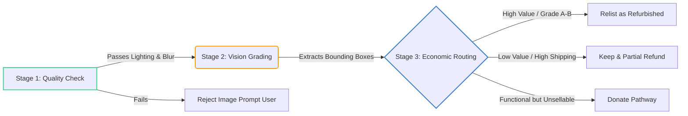

# ♻️ ReLife — AI-Powered Returns & Sustainable Resale

**HackOn with Amazon - Season 6.0**  
**Theme:** Second Life Commerce: AI-Powered Returns & Sustainable Resale

---

## 🌍 1. Problem Statement & Relevance

Millions of products bought online are returned, underused, or discarded despite being perfectly usable. Returns are inherently expensive for customers, sellers, and the planet. In India, returns account for a massive segment of e-commerce logistics, creating friction across the ecosystem:

*   **The Disappointed Buyer:** Forced into inconvenient return processes, while the returned item often ends up liquidated or in a landfill due to prohibitive restocking margins.
*   **The Passive Seller:** Holds onto functional, unused items because traditional peer-to-peer resale lacks a trusted, friction-free ecosystem within a major platform.
*   **The Squeezed Retailer:** Drowns in manual inspection pipelines. Grading and republishing returns takes dozens of hours, is highly error-prone, and leads to rapid inventory depreciation.

> **Our Core Insight:** Millions of functional products sit idle because there is no intelligent, trusted bridge to route them to their next best owner.

---

## 🎯 2. Customer & Solution

ReLife is an intelligent ecosystem where returned or unused products automatically find their next best owner. We automate return inspection, align pathways with real shipping economics, and display verified transparency metrics to buyers.

### Core Pillars
1.  **Return Prevention:** Predictive warnings, contextual sizing, and certified refurbished alternatives.
2.  **Smart Return Flow:** Guided live camera captures with instant AI photo quality checks.
3.  **Seller Intelligence:** Instant returns grading, copywriting automation, and analytics.
4.  **Product Trust Layer:** Interactive Product Health Cards mapping exact flaw coordinates.

### 🚀 Live Demo & Workflow
*   **Live Application URL:** [https://hack-on-kappa.vercel.app/](https://hack-on-kappa.vercel.app/)
*   **Demo Accounts:** 
    *   **Buyer Persona:** Session initializes automatically (`Conscious Shopper`).
    *   **Seller Persona:** Click **Seller Dashboard** in the navbar.

**How to Test the Implementation:**
1.  **Trigger Prevention:** Click the *Nike Air Force 1* on the homepage to view the dynamic Return Prevention Banner.
2.  **AI Grading in Action:** Go to *Orders* -> *Return Item* (MacBook Air). Use the guided camera flow.
3.  **Seller Resolution:** Navigate to the *Seller Dashboard*, view the AI's grading report, and click *Relist as Refurbished*.
4.  **Trust & Impact Verification:** View your newly relisted item complete with its AI-generated Product Health Card, then check your *Impact* dashboard for your earned sustainable incentives and "green credits".

---

## 🧠 3. Tech Architecture & Scaling

ReLife is architected for global scalability, utilizing serverless edge compute and AWS Bedrock for advanced decision intelligence.

### System Flow Architecture

```mermaid
sequenceDiagram
    autonumber
    participant Client as Buyer Client
    participant S3 as AWS S3 Bucket
    participant API as Next.js API Routes
    participant Bedrock as AWS Bedrock (Nova Pro)
    participant DB as Supabase (PostgreSQL)
    participant Seller as Seller Dashboard

    Client->>API: Request Presigned Upload URL
    API-->>Client: Secure S3 Token
    Client->>S3: Upload 4-Angle Captures Direct
    Client->>API: Submit Return Request
    
    rect rgb(23, 23, 23)
        Note over API, Bedrock: Background AI Pipeline
        API->>Bedrock: Base64 Vision Tokens (Quality & Flaws)
        Bedrock-->>API: JSON Grading & Flaw Coordinates
        API->>Bedrock: Financial Routing Request (INR)
        Bedrock-->>API: Economic Path Decision
    end
    
    API->>DB: Persist Inspection Results
    Seller->>DB: Fetch Pending Returns
    DB-->>Seller: Render HTML5 Canvas Overlays
    Seller->>API: Approve & Relist
    API->>DB: Generate Copy & Publish to Feed
```

### The AI Decision Pipeline

To optimize compute and ensure precision, the intelligence layer operates in a strict three-stage gateway:

### Technology Stack & Rationale

| Layer | Technology | Why We Chose It |
|---|---|---|
| **Frontend** | React, Next.js 14, Tailwind CSS | Edge-ready serverless rendering; enables dynamic canvas overlays for flaw mapping. |
| **Backend & Auth** | Next.js API Routes, Clerk | Eliminates CORS friction; scales instantly; seamless integration with Vercel deployment. |
| **Data & Auth** | Supabase (PostgreSQL) | Chosen for fast JSONB querying (crucial for storing dynamic AI bounding box coordinates). |
| **AI / ML** | AWS Bedrock (Nova Pro) | Model-agnostic conversational endpoints. Nova Pro delivers unparalleled multimodal vision capabilities. |
| **Storage** | AWS S3 | Direct client-to-bucket presigned uploads prevent serverless function memory timeouts. |

---

## 🔮 4. Future Vision & Roadmap

ReLife is built to scale beyond basic returns, driving an entirely new multi-segment ecosystem for the circular economy.

### Strategic Roadmap

| Horizon | Milestone | Impact Target |
|---|---|---|
| **0-3 Months** | **Peer-to-Peer Integration:** Enable direct buyer-to-buyer circular marketplace, bypassing warehouse routing. | Eliminate 100% of return transit costs for C2C matches. |
| **3-6 Months** | **AR Product Reviews & WhatsApp Bot:** Virtual overlays showing flaw locations on 3D models; WhatsApp bot for instant return approvals. | Increase buyer trust by 45%; lower return friction to near zero. |
| **6-12 Months** | **Carbon Ledger Exchange:** Direct integration where "green credits" can purchase certified carbon offsets from partner NGOs. | Solidify platform's position as a verified ESG leader. |

### Multi-Segment Expansion
While currently optimized for consumer electronics and apparel, the underlying vision architecture and JSONB database schema can seamlessly expand to Furniture & Home Goods, Automotive Parts, and Industrial Hardware—industries where return shipping logistics are exponentially more punishing.

---

## 👨‍💻 Team

We are a highly specialized engineering team focused on building production-ready, disruptive AI tools.

| Name | Role | Profile |
|---|---|---|
| **Chinmay Nandawat** | Full-Stack & Database Architect | Implemented Next.js views, marketplace layouts, Supabase migrations, and platform metrics components. |
| **Abhnish Kumar** | Cloud Infrastructure & AI Engineer | Built S3 presigned integrations, AWS Bedrock Converse utilities, vision grading APIs, and backend orchestrators. |

> *"Building the future of sustainable commerce where every product gets a meaningful second life."*
