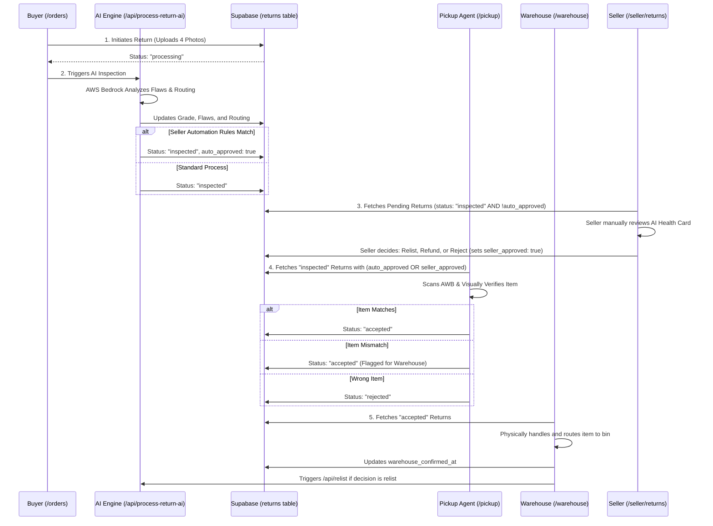
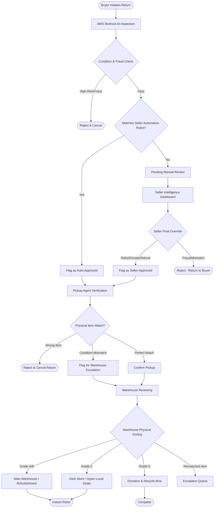

# ReLife Platform: End-to-End Flow & Architecture

This document outlines the complete architectural flow of the ReLife smart returns platform. It serves as a technical reference guide for how data moves through the database, which APIs are triggered, and how each dashboard communicates with the central Supabase backend.

## 🔄 Complete Flowchart

## 🔄 High-Level Process Flow

---

## 🛠️ Phase-by-Phase Technical Breakdown

### 1. Buyer Return Initiation (`/orders` -> `/returns/new`)
* **Trigger:** Buyer clicks "Initiate Return" on a past order.
* **Logic:** 
  * Buyer is forced to capture 4 live photos (Front, Back, Side, Damage) preventing gallery fraud.
  * Optionally selects a return reason.
* **Database State:** 
  * A new row is inserted into the `returns` table.
  * Initial `status` is set to `"processing"`.
  * `return_photo_urls` are populated with S3/Supabase storage links.

### 2. Instant AI Inspection (`/api/process-return-ai`)
* **Trigger:** Called automatically upon return submission.
* **Logic:** 
  * Sends the 4 photos and buyer reason to AWS Bedrock.
  * The LLM calculates the `ai_grade` (A/B/C/D), generates bounding box data (`flaws_json`), and determines a `routing_decision`.
  * **Seller Automation Check:** The API checks the Seller's automation settings (`/api/seller-automation-rules`). If the item matches the rules (e.g., Value < $50, Trust Score > 80, Grade A/B), the AI attaches an invisible `auto_approved: true` flag.
* **Database State:** 
  * `status` transitions to `"inspected"`.
  * `ai_grade`, `ai_score`, and `flaws_json` are saved to the `returns` table.

### 3. Seller Intelligence Dashboard (`/seller/returns`)
* **Trigger:** Seller manages their inventory BEFORE pickup.
* **Logic:** 
  * The dashboard fetches all returns from the DB.
  * **Pending AI/Manual Tab:** Filters for `status === "inspected"`. Hides any items where `auto_approved === true` or `seller_approved === true`.
  * Seller views the dual-column AI Health Card with precise flaw bounding boxes.
  * Seller makes a manual override decision (Relist, Refund, Reject).
* **Database State:** 
  * If Relist/Refund: the `flaws_json` is updated with `seller_approved: true` so it proceeds to pickup.
  * If Reject: `status` transitions to `"rejected"`.

### 4. Logistics Pickup Terminal (`/pickup`)
* **Trigger:** Delivery agent arrives at the buyer's doorstep.
* **Logic:** 
  * Terminal fetches all returns where `status === "inspected"` AND they are approved (`auto_approved` or `seller_approved`).
  * Agent scans the AWB barcode, which pulls up the AI's generated Health Card and photos.
  * Agent visually verifies the physical item against the AI's photos.
* **Database State:** 
  * If the agent clicks "Match": `status` transitions to `"accepted"`.
  * If the agent clicks "Mismatch": `status` transitions to `"accepted"`, but a `pickup_flagged: true` flag is added to alert the warehouse.
  * If "Wrong Item": `status` transitions to `"rejected"`.

### 5. Warehouse Physical Handling (`/warehouse`)
* **Trigger:** The delivery truck arrives at the sorting facility.
* **Logic:** 
  * Terminal fetches returns where `status` is `"accepted"`.
  * It splits them into a Physical Handling Queue (for routing to bins) and an Escalation Queue (for items flagged during pickup).
  * Worker clicks "Confirm Received" to acknowledge physical custody.
* **Database State:** 
  * Updates `warehouse_confirmed_at` with the current timestamp.
  * **Automation Trigger:** Triggers `/api/relist` if the routing decision is `relist_as_refurbished` (which transitions `status` to `"relisted"`). If donate/recycle, changes status to `"completed"`.

### 6. Seller Automation Studio (`/seller/automation`)
* **Logic:** A settings dashboard where sellers can configure the criteria for bypassing phase 5. Rules (like Max Value, Min Trust Score, Eligible Grades) are saved and queried by `/api/process-return-ai` during Phase 2.
